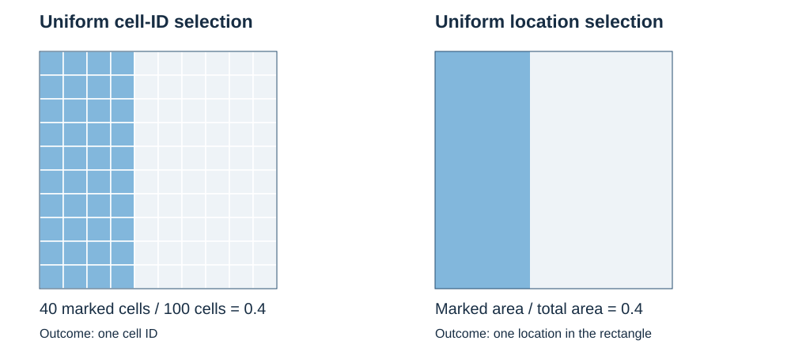

**Data Analytics for AI · Executive M.Tech · IIT Jammu**  
**Module 01 · Fundamentals of Probability and Random Signal Theory**

[Previous lecture](01-probability-foundations.qmd) · [Advanced supplement](02-random-variables-supplement.qmd) · [01.3 tutorial: coins, records and ticket durations](02-joint-distributions-tutorial.qmd) · [01.4 meeting problem](04-meeting-problem.qmd)

## Questions for this lecture

A manufacturing supervisor asks how many components in a tested batch need replacement. An accountant asks how often an invoice contains a discrepancy. An engineer asks whether two sensors both meet their tolerances. A logistics planner asks whether delayed deliveries are more common on longer routes. Each question concerns a numerical recording of an outcome, but the required distribution differs.

We will learn to:

- construct and use a probability mass function (PMF) for discrete values;
- calculate probabilities from a probability density function (PDF) for continuous measurements;
- use a cumulative distribution function (CDF) for either type;
- describe two quantities with a joint distribution;
- obtain marginal distributions by adding or integrating over the other quantity;
- obtain conditional distributions by restricting to the information given and normalizing;
- check whether independence is justified.

The treatment uses counting, sums, areas and elementary integrals. Technical proofs and exceptional cases are in the supplement. All numerical records and models below are **hypothetical or stipulated for teaching**. Worked examples include calculations; independent exercises at the end do not include answers.

::: {.callout-note title="Recall the probability model: outcomes, events and weights"}
An outcome is one result of the experiment; an event is a set of outcomes. The model is $(\Omega,\mathcal F,P)$.

The **power set** $\mathcal P(\Omega)=2^\Omega$ is the collection of all subsets of $\Omega$. We use it as the event collection for our finite examples. A **sigma-algebra** is an event collection containing $\Omega$ and closed under complements and countable unions; it consequently contains the empty set and countable intersections too. Thus the model can express “not,” “at least one” and “all” for the relevant lists of events.

Kolmogorov's axioms say that probabilities are nonnegative, the whole space has probability 1, and probabilities add over countably many pairwise disjoint events. They do **not** require equal outcome weights. A random variable assigns a number to an outcome; its PMF collects the probability weights of all outcomes producing each numerical value.

See the [definition boxes in Lecture 01.1](01-probability-foundations.qmd#from-a-calculation-to-the-triplet-and-axioms) for small examples and the distinction between an event collection and a probability assignment.
:::

## 1. From selected records to a discrete distribution

### Worked example 1: replacement counts in inspected batches

A workshop inspects ten batches of electrical connectors, each containing the same number of connectors. Inspectors record how many connectors in each batch require replacement. A supervisor wants to know how often a batch in this completed inspection needs at least two replacements, because such batches require an additional quality review.

The experiment is to select one of the ten batch IDs uniformly, so each ID has probability $1/10$. These are fixed inspection records:

| Batch ID | $b_1$ | $b_2$ | $b_3$ | $b_4$ | $b_5$ | $b_6$ | $b_7$ | $b_8$ | $b_9$ | $b_{10}$ |
|---|---:|---:|---:|---:|---:|---:|---:|---:|---:|---:|
| Replacements | 0 | 0 | 0 | 0 | 1 | 1 | 1 | 2 | 2 | 3 |

What is the probability that the selected batch requires the additional review?

Three batch IDs meet the condition, so the probability is $3/10$. Let $X(b_i)$ be the recorded number of replacements. The outcomes are batch IDs; $X$ records a number for the selected ID. Collecting IDs with the same number gives:

| $x$ | 0 | 1 | 2 | 3 |
|---|---:|---:|---:|---:|
| Number of IDs | 4 | 3 | 2 | 1 |
| $P(X=x)$ | $0.4$ | $0.3$ | $0.2$ | $0.1$ |

Thus $P(X\ge2)=0.2+0.1=0.3$. The four numerical values are not equally likely even though the ten batch IDs are.

### The PMF after the calculation

::: {.callout-note title="Definition: a discrete random variable and its PMF"}
A random variable is **discrete** when its values lie in a finite or countably infinite set with probability 1. Its **probability mass function** is

$$p_X(x)=P(X=x).$$

A valid PMF satisfies

$$p_X(x)\ge0,\qquad \sum_x p_X(x)=1.$$

For a set of values $A$,

$$P(X\in A)=\sum_{x\in A}p_X(x).$$

:::

The sum runs over possible values; values outside the stated range have mass zero. For the batch-inspection example, the masses sum to $0.4+0.3+0.2+0.1=1$. The distribution describes uniform selection from these fixed records. The [worked appendix](#appendix-ticket-triplet) explicitly constructs a finite probability triplet and the event groups behind a PMF using a separate ticket dataset. A forecast for future production requires assumptions about whether the production process and inspection criteria remain comparable.

### Worked example 1a: a deliberately nonuniform die

A stipulated six-sided device has outcome weights proportional to $1,1,2,2,3,3$ for faces 1 through 6. Let $D$ record the face. The weights sum to 12, so

| $d$ | 1 | 2 | 3 | 4 | 5 | 6 |
|---|---:|---:|---:|---:|---:|---:|
| $p_D(d)$ | $1/12$ | $1/12$ | $2/12$ | $2/12$ | $3/12$ | $3/12$ |

All masses are nonnegative and sum to 1. For the two largest faces,

$$P(D\ge5)=\frac3{12}+\frac3{12}=\frac12.$$

Counting two favorable faces out of six would give $1/3$, which is wrong for this specified mechanism. We must add their weights. A finite sample space and the full power set remain valid when the outcome weights are unequal.

### Worked example 1b: number of failed electrical supplies

An equipment engineer is assessing a device with two power supplies. Either supply can keep the device running alone; the device loses power only if both fail. Let $N$ count failed supplies at a specified inspection time. The engineer wants to distinguish the chance of any failed supply, which triggers maintenance, from the chance of losing power. Stipulate the joint states and their probabilities below. These are model weights, not an assumption that all four states are equally likely.

| State of supplies 1 and 2 | Both work | Only supply 1 fails | Only supply 2 fails | Both fail |
|---|---:|---:|---:|---:|
| Probability | $0.72$ | $0.18$ | $0.08$ | $0.02$ |
| Failure count $N$ | 0 | 1 | 1 | 2 |

To obtain the PMF of the number of failures, combine the weights of states producing the same count:

$$p_N(0)=0.72,\qquad p_N(1)=0.18+0.08=0.26,\qquad p_N(2)=0.02.$$

Thus $P(N\ge1)=0.26+0.02=0.28=1-0.72$. Neither counting three failure states out of four nor assigning $1/3$ to each possible count is justified. The chance of losing power is instead $P(N=2)=0.02$. These two events answer different operational questions. Independence of the two supplies is not assumed; their joint state probabilities have been supplied directly.

::: {.callout-tip title="Two reasons a discrete distribution may be nonuniform"}
In the batch inspection, equally likely IDs produce unequal PMF masses because different numbers of batches have each replacement count. In the supply model, the elementary states already have unequal weights, and states with the same count have their weights added. In both cases,

$$P(X=x)=\sum_{\omega:X(\omega)=x}P(\{\omega\})$$

for the finite experiments considered here. Counting is the special case where every elementary weight is $1/|\Omega|$.
:::

### Worked example 2: accounting discrepancy counts

An accounts team has completed a review of twelve invoices. A discrepancy is a recorded mismatch in a field such as the billed quantity or agreed price; an invoice can contain more than one. Seven invoices have no discrepancy, three have one, and two have two. The team asks: if one invoice is selected uniformly from this reviewed set, what is the chance it needs correction?

Let $D$ count discrepancies on the selected invoice. Each invoice ID has probability $1/12$, so

$$p_D(0)=\frac7{12},\qquad p_D(1)=\frac3{12},\qquad p_D(2)=\frac2{12}.$$

The probability of at least one discrepancy is

$$P(D\ge1)=\frac3{12}+\frac2{12}=1-\frac7{12}=\frac5{12}.$$

There are seven discrepancy instances across the twelve invoices: three on the one-discrepancy invoices and four on the two-discrepancy invoices. Selecting an invoice uniformly is a different experiment from selecting one of those seven instances uniformly. State the sampling unit before choosing the denominator.

### Worked example 2a: financial loss records

A finance team reviews eight completed foreign-currency settlements. Relative to its budgeted exchange rate, four settlements have recorded loss ₹0, three have ₹50, and one has ₹200; none has a gain in this small teaching dataset. The reviewer selects one settlement ID uniformly. Let $L$ be its recorded loss in rupees. What fraction of these settlements lost more than ₹50, and how does the answer change if the threshold includes ₹50? The PMF is $p_L(0)=4/8$, $p_L(50)=3/8$ and $p_L(200)=1/8$, with zero mass elsewhere. Consequently $P(L>50)=1/8$, whereas $P(L\ge50)=4/8$. The currency values are the random-variable values; the fractions are their probabilities. This is selection from fixed records, not a forecast of future losses.

### Worked example 3: a countably infinite PMF

For a stipulated IT retry model, let $N$ be the number of failures before the first successful attempt, with

$$p_N(n)=\frac34\left(\frac14\right)^n,\qquad n=0,1,2,\ldots.$$

This model corresponds to independent attempts with success probability $3/4$ on every attempt, continued until success. Here independence means that learning the outcomes of earlier attempts does not change the stipulated success probability of the next attempt. Section 7 gives the formal independence condition. There is no fixed maximum count. The geometric-series identity verifies the PMF:

$$\sum_{n=0}^{\infty}p_N(n)=\frac34\frac1{1-1/4}=1.$$

At least two failures before success has probability

$$P(N\ge2)=1-p_N(0)-p_N(1)
=1-\frac34-\frac3{16}=\frac1{16}.$$

Actual retries may have changing success chances or a retry limit; those require a different model. The example shows that “discrete” does not mean “only finitely many values.”

## 2. Accumulated probability: the CDF

### Worked example 4: a replacement-count threshold

Return to the ten inspected batches in Example 1, with $X$ the replacement count. Suppose the workshop can replace at most one connector per batch during its routine processing slot. What proportion of the recorded batches fit within that capacity? The batches with zero or one replacement qualify, giving $4/10+3/10=0.7$.

If capacity changes, we need the probability that $X$ is **at most** each possible threshold. For thresholds 0, 1 and 2 the answers are $0.4$, $0.7$ and $0.9$. A single function can collect these answers.

The **cumulative distribution function** of any real-valued random variable is

$$F_X(x)=P(X\le x).$$

Here it is the step function

$$F_X(x)=\begin{cases}
0,&x<0,\\
0.4,&0\le x<1,\\
0.7,&1\le x<2,\\
0.9,&2\le x<3,\\
1,&x\ge3.
\end{cases}$$

For example, $F_X(1.5)=0.7$: counts 0 and 1 are included. The jump at 2 is $0.2$, the probability of exactly two replacements. The CDF is nondecreasing, right-continuous, and approaches 0 and 1 at the two ends of the real line.

The interval rule is

$$P(a<X\le b)=F_X(b)-F_X(a),\qquad a<b.$$

Consequently $P(1<X\le3)=1-0.7=0.3$. Including 1 changes the answer: $P(1\le X\le3)=0.3+0.2+0.1=0.6$. At a value carrying positive probability, endpoint wording matters.

**Stopping point 1.** Work several PMF and CDF questions before introducing density. Learners should be able to distinguish a possible value from its probability and explain which values a threshold includes.

## From counting outcomes to measuring length and area {#counting-to-area}

### Worked bridge: uniform grid selection and a uniform location

Divide a rectangular field into 10 rows and 10 columns of equal-area cells. The leftmost four columns are marked for inspection. Select one of the 100 cell IDs uniformly. Forty IDs are marked, so

$$P(\text{marked cell})=\frac{40}{100}=0.4.$$

Now describe a different experiment: select a location uniformly by area over the field. The marked region occupies four tenths of the field's width and its full height. Its area is therefore four tenths of the total, giving

$$P(\text{marked location})=\frac{\text{marked area}}{\text{total area}}=0.4.$$

The answers agree because the cells have equal areas and the region is exactly their union. Cell selection produces an ID; location selection produces a point. If cells had unequal areas, uniform selection of their IDs would not be uniform location selection. This is the same distinction as selecting farm plots by ID or by area in Lecture 01.1.

::: {.callout-note title="What replaces counting in a continuous uniform model?"}
For equally likely finite outcomes, probability is the fraction of total **count**:

$$P(E)=\frac{\#E}{\#\Omega}.$$

For a uniform location in a finite interval or region, probability is the fraction of total **length** or **area**:

$$P(E)=\frac{\operatorname{length}(E)}{\operatorname{length}(\Omega)},
\qquad
P(E)=\frac{\operatorname{area}(E)}{\operatorname{area}(\Omega)},$$

respectively, for the ordinary measurable events used here and positive finite total length or area. These are different models sharing the idea of normalizing the appropriate size to total probability 1.

We do not count the individual points in a continuous interval or region. Each point has zero length or area, while an interval or region can have positive size. Countable additivity does not instruct us to sum over uncountably many singleton points.
:::

For a curved marked region, an increasingly fine equal-area grid can approximate its area using the fraction of marked cells. For ordinary regions whose boundaries have area zero, the uncertainty from cells touching the boundary vanishes as the grid is refined. The limiting area is the quantity used in the continuous model; a finite grid remains a discrete approximation.

::: {.callout-tip title="Beyond uniformity: weights become density times width or area"}
In a discrete model we add probability weights, $P(X\in A)=\sum_{x\in A}p_X(x)$. In a density model, a small interval near $x$ has probability approximately $f_X(x)\,\Delta x$ when the density varies little across it. Adding these small contributions leads to the integral $\int_A f_X(x)dx$.

For a location in a plane, a small cell contributes approximately $f_{X,Y}(x,y)\,\Delta x\,\Delta y$. Integrating these contributions gives a region's probability. Uniform density makes this proportional to geometric area; a varying density gives different weights to equal-area cells.

For example, on the unit interval the uniform density gives $P(X\le0.4)=0.4$. Under the stipulated nonuniform density $f_X(x)=2x$ on $(0,1)$, the same event instead has probability $\int_0^{0.4}2x\,dx=0.16$. Its length has not changed; the model's probability weights have.
:::

## 3. Continuous measurements: density and area

### Worked example 5: voltage tolerance

An engineer checks a voltage meter against a known reference. Define its error $V$ as the displayed voltage minus the reference voltage: a negative value means the meter reads too low. A reading meets the specified tolerance when its error is between $-0.04$ and $0.04$ volts.

For this simplified measurement model, stipulate that $V$ is uniform on $[-0.1,0.1]$ volts. Uniformity means equal-length error intervals within this range have equal probabilities. What is the probability that a reading meets the tolerance, that is, $|V|\le0.04$?

The acceptable interval has length $0.08$ V and the full interval has length $0.2$ V, giving

$$P(|V|\le0.04)=\frac{0.08}{0.2}=0.40.$$

Its density is

$$f_V(v)=\begin{cases}5,&-0.1\le v\le0.1,\\0,&\text{otherwise}.\end{cases}$$

The density height has units V$^{-1}$. Multiplying by interval width gives the probability $5(0.08)=0.40$. A density height can exceed 1; the total area must be 1. Here it is $5(0.2)=1$.

### The PDF after the calculation

::: {.callout-note title="Definition and interpretation: a probability density function"}
For the continuous models in this lecture, a **probability density function** $f_X$ is nonnegative and satisfies

$$\int_{-\infty}^{\infty}f_X(x)\,dx=1,\qquad
P(a\le X\le b)=\int_a^b f_X(x)\,dx.$$

Probability is area under the density, not its height at a point. In a density model $P(X=x)=0$ for every individual $x$, so including or excluding interval endpoints does not change the probability. A rounded measurement is different: a display reading usually represents a small interval of possible underlying values.

:::

In this lecture “continuous” refers to variables described by a density. Mixed distributions and a qualification to this terminology are discussed in the supplement.

### Worked example 6: a nonuniform latency density

An IT team is examining the time from sending a database request to receiving its response. For this teaching model, every request completes within two seconds, and longer times within this range have greater probability density. Let $T$ be the response time in seconds. The team wants the probability of missing a one-second response target. Stipulate the density

$$f_T(t)=\begin{cases}t/2,&0\le t\le2,\\0,&\text{otherwise}.\end{cases}$$

Here $t$ is the numerical latency in seconds; dimensionally the coefficient $1/2$ has units s$^{-2}$, so the density has units s$^{-1}$.

First verify the model:

$$\int_0^2\frac t2\,dt=\left[\frac{t^2}{4}\right]_0^2=1.$$

What is the chance of latency exceeding 1 second?

$$P(T>1)=\int_1^2\frac t2\,dt
=\left[\frac{t^2}{4}\right]_1^2=\frac34.$$

The interval $(1,2]$ is half the full interval's length, but contains three quarters of the probability. Ratios of lengths apply to a uniform density, not to every continuous model.

The CDF is

$$F_T(t)=\begin{cases}0,&t<0,\\t^2/4,&0\le t\le2,\\1,&t>2.\end{cases}$$

This follows by integrating from 0 to $t$. It also gives $P(0.5<T\le1.5)=F_T(1.5)-F_T(0.5)=(2.25-0.25)/4=1/2$. For a density model, $F_T(t)=\int_{-\infty}^t f_T(u)\,du$; where the CDF is differentiable, its derivative gives a version of the density. Here $F_T'(t)=f_T(t)$ except at $t=2$.

### Worked example 7: a rounded display value

In the same model, a system displays latency rounded to the nearest tenth of a second. Ignoring tie endpoints, a displayed value 1.0 represents $0.95\le T<1.05$. Thus

$$P(\text{display}=1.0)=\frac{1.05^2-0.95^2}{4}=0.05.$$

This does not conflict with $P(T=1)=0$. The displayed variable is a discrete recording of the continuous latency.

## 4. Two recordings on the same outcome: a joint PMF

### Worked example 8: tool retries and an evaluation result

An evaluation team has completed 20 runs of an AI assistant that retrieves information through an external tool. A tool retry is an additional attempt after a tool call fails; passing means the final answer satisfies a fixed reviewer checklist. A run can recover after a retry, and a run without retries can still give an incorrect answer.

The team wants to describe how retries and final results occur together. Select one of these 20 run IDs uniformly; the outcome is the entire selected run, with both of its recorded quantities:

- $X$: number of tool retries, taking values 0, 1 or 2;
- $Y$: evaluation result, with 1 for pass under a fixed review protocol and 0 for fail.

The hypothetical counts are:

| Retry count $X$ | $Y=0$ | $Y=1$ | Row total |
|---|---:|---:|---:|
| 0 | 2 | 8 | 10 |
| 1 | 3 | 3 | 6 |
| 2 | 3 | 1 | 4 |
| Column total | 8 | 12 | 20 |

What is the probability that a selected run passes and has at least one retry? The relevant cells contain $3+1=4$ IDs, so it is $4/20=0.2$.

Both numbers are recorded on the **same selected run**. The **joint PMF** is

$$p_{X,Y}(x,y)=P(X=x,Y=y),$$

where the comma means “and.” Divide each cell count by 20:

| $p_{X,Y}(x,y)$ | $y=0$ | $y=1$ |
|---|---:|---:|
| $x=0$ | $0.10$ | $0.40$ |
| $x=1$ | $0.15$ | $0.15$ |
| $x=2$ | $0.15$ | $0.05$ |

The entries are nonnegative and add to 1. Probabilities of conditions on the pair are found by summing the corresponding cells. For instance,

$$P(X=0\text{ or }Y=1)=0.10+0.40+0.15+0.05=0.70.$$

The cell $(0,1)$ is included once. These probabilities describe uniform selection from the fixed audit. They do not establish that retries cause failure or predict future agent performance.

## 5. Marginals: retain one recording

### Worked example 9: retry counts without the evaluation result

The evaluation team now asks a resource-planning question: how many retries occurred, regardless of whether the final answer passed? A failed run still consumes tool calls, so both result columns must contribute. In Example 8, add across both result columns:

$$p_X(0)=0.10+0.40=0.50,\quad
p_X(1)=0.15+0.15=0.30,\quad
p_X(2)=0.15+0.05=0.20.$$

Adding down rows gives $p_Y(0)=0.40$ and $p_Y(1)=0.60$.

These are the **marginal PMFs**:

$$p_X(x)=\sum_y p_{X,Y}(x,y),\qquad
p_Y(y)=\sum_x p_{X,Y}(x,y).$$

A marginal includes all possible values of the other recording. It does not require independence. For example, $P(X\ge1)=0.30+0.20=0.50$ and $P(Y=1)=0.60$.

### Worked example 9a: delivery delays and route type

A distributor reviews 30 completed deliveries. Each delivery is classified as local or regional; “late” means it arrived after the promised delivery time. Select one delivery ID uniformly from these records. Let $R=0$ indicate a local route and $R=1$ a regional route; let $D=1$ indicate late arrival and $D=0$ on-time arrival.

| Route | On time, $D=0$ | Late, $D=1$ | Total |
|---|---:|---:|---:|
| Local, $R=0$ | 16 | 4 | 20 |
| Regional, $R=1$ | 6 | 4 | 10 |
| Total | 22 | 8 | 30 |

The planner asks three questions. What is the chance of selecting a late regional delivery? How often is a delivery late regardless of route? Among regional deliveries, how often is it late?

The **joint** probability uses one cell and all 30 deliveries:

$$P(R=1,D=1)=rac4{30}=rac2{15}.$$

The **marginal** probability of lateness combines both route types:

$$P(D=1)=rac4{30}+rac4{30}=rac8{30}=rac4{15}.$$

For the third question, only the ten regional deliveries are relevant. Four are late, so the probability within that group is $4/10=0.4$. This previews a **conditional** probability, developed in Section 6. For local deliveries the corresponding fraction is $4/20=0.2$. Equal numbers of late deliveries do not imply equal late-arrival rates when group sizes differ.

The other marginal is $P(R=0)=20/30$ and $P(R=1)=10/30$. Together these calculations distinguish a joint event, a distribution with the route ignored, and a distribution within one route group. They describe the selected records; route type alone has not been established as the cause of lateness.

### Worked example 10: why marginals do not determine the joint table

A training programme assesses each submitted project on two criteria: technical correctness and clarity of explanation. Code a pass as 1 and a fail as 0 for each criterion. Suppose each criterion separately has pass probability $1/2$ under the stated selection of a submission. The programme coordinator wants to know how often the same project passes both criteria. Are the two separate pass rates enough to answer?

Consider two stipulated joint models for the pair of indicators:

| Pair of pass indicators | $(0,0)$ | $(0,1)$ | $(1,0)$ | $(1,1)$ |
|---|---:|---:|---:|---:|
| Model A | $1/4$ | $1/4$ | $1/4$ | $1/4$ |
| Model B | $1/2$ | 0 | 0 | $1/2$ |

Each model gives probability $1/2$ of passing either individual check. However, the probability of passing both is $1/4$ in A and $1/2$ in B. Knowing separate pass rates is insufficient to determine how often the rubrics both give a pass on the same submission.

## 6. Conditionals: restrict the group, then normalize

### Worked example 11: pass probability among runs with one retry

In Example 8, six IDs have exactly one retry, and three of those pass. If selection is uniform **within those six IDs**, the pass probability is $3/6=1/2$.

The probability of “one retry and pass” in the full audit is $3/20$. The probability of selecting the one-retry group is $6/20$. Their ratio gives

$$P(Y=1\mid X=1)=\frac{3/20}{6/20}=\frac12.$$

For events $A,B$ with $P(B)>0$, **conditional probability** is

$$P(A\mid B)=\frac{P(A\cap B)}{P(B)}.$$

The condition changes the group to which probabilities refer. In this example, $A$ is the pass event and $B$ is the one-retry event; the numerator counts IDs satisfying both.

The **conditional PMF** follows:

$$p_{Y\mid X}(y\mid x)=\frac{p_{X,Y}(x,y)}{p_X(x)},\qquad p_X(x)>0.$$

For a fixed $x$, its probabilities over $y$ sum to 1. In this audit the conditional pass probabilities for $x=0,1,2$ are $0.8,0.5,0.25$. The conditional fail probabilities are their complements.

Reversing the condition changes the denominator:

$$P(X=1\mid Y=1)=\frac{3/20}{12/20}=\frac14.$$

“One retry among passes” and “pass among one-retry runs” are different questions. Conditioning on an absent group, such as $X=3$ in this audit, cannot be computed by this ratio because its denominator is zero.

### Worked example 12: recovering an overall pass probability

Combine the conditional pass probabilities using the retry-group probabilities:

$$\begin{aligned}
P(Y=1)&=P(Y=1\mid X=0)p_X(0)\\
&\quad+P(Y=1\mid X=1)p_X(1)+P(Y=1\mid X=2)p_X(2)\\
&=0.8(0.5)+0.5(0.3)+0.25(0.2)=0.60.
\end{aligned}$$

The unweighted average of the three conditional rates is inappropriate because the groups have unequal sizes. More generally,

$$p_Y(y)=\sum_{x:p_X(x)>0}p_{Y\mid X}(y\mid x)p_X(x).$$

Equivalently, a joint mass can be reconstructed as $p_{X,Y}(x,y)=p_{Y\mid X}(y\mid x)p_X(x)$. Conditional rates without group weights do not determine the marginal rate.

At the event level the same rearrangement gives $P(A\cap B)=P(A\mid B)P(B)$ when $P(B)>0$. This justifies the ordered-draw rule used in Lecture 01.1: choosing uniformly from $n$ objects, then uniformly from the remaining $n-1$, assigns a specified ordered pair probability $(1/n)\cdot(1/(n-1))$.

### Worked example 13: agricultural condition and germination

A nursery has completed a germination trial on 20 trays, each planted with the same number of seeds. Each tray is labelled adequately watered or dry using a recorded moisture criterion. A tray reaches the target if at least 80% of its seeds germinate by day 10. Twelve trays carry the adequate-water label, and nine of these reach the target. Of the eight dry-labelled trays, two reach it.

Select one tray ID uniformly from these completed records. The nursery wants to compare the target rate within each moisture group, calculate the overall target rate, and then ask the reverse question: among trays that reached the target, how many had the adequate-water label? These questions use different denominators.

The probability of reaching the target given the adequate-water label is $9/12=3/4$. Given the dry label it is $2/8=1/4$. The overall probability is

$$\frac34\cdot\frac{12}{20}+\frac14\cdot\frac8{20}=\frac{11}{20}.$$

Among the 11 trays reaching the target, the probability of the adequate-water label is instead $9/11$. Writing $A$ for adequate water and $H$ for reaching the target, this reversal is an application of **Bayes' rule**:

$$P(A\mid H)=\frac{P(H\mid A)P(A)}{P(H)}
=\frac{(3/4)\cdot(12/20)}{11/20}=\frac9{11}.$$

 This calculation describes the given records; it does not isolate the causal effect of watering from seed type or other differences.

## 7. Independence is a property to check

### Worked example 14: do retries and the result behave independently?

In Example 8, the overall pass probability is $0.60$, but the pass probability given zero retries is $0.80$. Knowing the retry count changes the distribution of the result. They are not independent under this audit-selection model.

Two events $A,B$ are **independent** if $P(A\cap B)=P(A)P(B)$. For example, in the audit the events “zero retries” and “pass” have intersection probability $0.40$, rather than $0.50\cdot0.60$, so those events are dependent.

For discrete variables, **independence** means

$$p_{X,Y}(x,y)=p_X(x)p_Y(y)\quad\text{for every pair }(x,y).$$

One mismatch disproves it: $p_{X,Y}(0,1)=0.40$, whereas $p_X(0)p_Y(1)=0.50(0.60)=0.30$. To establish independence, the factorization must hold for every pair, including pairs with zero mass. In Example 10, Model A factors for every cell; Model B does not.

**Stopping point 2.** Before moving to two-dimensional densities, work with the count table until joint, marginal and conditional questions lead to the correct cells and denominators.

## 8. A joint PDF: two continuous measurements

### Worked example 15: two sensor errors

A positioning system measures the same component with two displacement sensors. For each simultaneous measurement, subtract the known reference position from each sensor reading. Let $U,V$ be the resulting signed errors in millimetres. A measurement pair is accepted only if both errors are within $0.5$ mm of zero. What is the model probability of acceptance?

Stipulate that the pair of errors is uniform over the square $-1\le u\le1$, $-1\le v\le1$, with errors in mm. The square has area 4 mm$^2$, so its constant joint density is $1/4$ mm$^{-2}$.

Both sensors being within $0.5$ mm means $(U,V)\in[-0.5,0.5]^2$. This smaller square has area 1 mm$^2$, hence

$$P(|U|\le0.5,|V|\le0.5)=\frac14(1)=\frac14.$$

A **joint PDF** $f_{U,V}$ is nonnegative, integrates to 1 over the plane, and gives probabilities by integrating over the requested region $A$:

$$P((U,V)\in A)=\iint_A f_{U,V}(u,v)\,du\,dv.$$

For this model the density is $1/4$ inside the square and zero outside. Probability comes from density multiplied by area, not from a point value of the density. The region on which a model can place probability is its **support**; always state it together with the formula.

### Worked example 16: an elapsed time inside a total duration

A maintenance team records two times for a completed repair: the time of an intermediate inspection and the time the repair finishes, both measured from the start. The inspection must precede completion. For a simplified model, assume every repair finishes within a one-hour reference period. Let $X$ be total duration divided by one hour and $Y$ be inspection time divided by one hour. Thus $X=0.8$ means completion at 48 minutes, and $Y=0.2$ means inspection at 12 minutes.

The planner asks how often completion is within 30 minutes and how often inspection occurs before half of the repair's own duration has elapsed. These are different events. Stipulate the joint PDF

$$f_{X,Y}(x,y)=\begin{cases}2,&0<y<x<1,\\0,&\text{otherwise}.\end{cases}$$

The triangular support expresses that the inspection happens before completion. The time scale is one chosen reference duration; $X,Y$ are dimensionless fractions. A physical task is not automatically uniform on this triangle: uniformity is the model assumption.

The triangle has area $1/2$, so total probability is $2(1/2)=1$. Written as an integral,

$$\int_0^1\int_0^x2\,dy\,dx=\int_0^1 2x\,dx=1.$$

What is the probability that completion occurs by the halfway point of the reference duration?

$$P(X\le1/2)=\int_0^{1/2}\int_0^x2\,dy\,dx
=\int_0^{1/2}2x\,dx=\frac14.$$

What is the probability that the inspection occurs in the first half of the task's own duration?

$$P(Y<X/2)=\int_0^1\int_0^{x/2}2\,dy\,dx=\int_0^1x\,dx=\frac12.$$

The upper integration limit changes with $x$. Replacing this triangle with a rectangle would describe a different model.

## 9. Marginal and conditional densities

### Worked example 17: marginal durations from the triangle

For a fixed total duration $x$, the inspection time ranges from 0 to $x$. Integrate along that vertical slice:

$$f_X(x)=\int_0^x2\,dy=2x,\qquad 0<x<1.$$

For a fixed inspection time $y$, completion must fall between $y$ and 1:

$$f_Y(y)=\int_y^1 2\,dx=2(1-y),\qquad 0<y<1.$$

Both densities are zero elsewhere. Each integrates to 1. For example,

$$P(Y>1/2)=\int_{1/2}^1 2(1-y)\,dy=\frac14.$$

In general the **marginal densities** are

$$f_X(x)=\int_{-\infty}^{\infty}f_{X,Y}(x,y)\,dy,\qquad
f_Y(y)=\int_{-\infty}^{\infty}f_{X,Y}(x,y)\,dx.$$

The stated support determines where the integrand is nonzero and hence the effective bounds.

### Worked example 18: inspection time for a given duration

In the same model, consider tasks with total duration close to $x=0.8$. The allowable inspection times occupy $0<y<0.8$, and the joint density is constant along the slice. Normalizing that slice gives density $1/0.8$ on this interval. Therefore the model's conditional probability of inspection before 0.2 is

$$P(Y<0.2\mid X=0.8)=\int_0^{0.2}\frac1{0.8}\,dy=\frac14.$$

The general **conditional density** formula is

$$f_{Y\mid X}(y\mid x)=\frac{f_{X,Y}(x,y)}{f_X(x)},\qquad f_X(x)>0.$$

For the triangular model it is $1/x$ on $0<y<x$ and zero otherwise. For each fixed $0<x<1$, its integral over $y$ is 1. A conditional probability is found by integrating it over the requested range of $y$.

Since $X$ has a density, $P(X=0.8)=0$. This formula is **not** the elementary event ratio with $P(X=0.8)$ in the denominator. For this regular density model it describes the limiting distribution in increasingly narrow duration bands around 0.8. The supplement gives the precise qualification. If a duration is rounded or measured over a band, condition on that band instead.

### Worked example 19: conditioning on a band

Suppose the maintenance report groups repairs by duration: we know only that a selected repair took between 36 and 48 minutes. The planner asks for the probability that its inspection occurred before minute 12. In the normalized variables of Example 16, this is $P(Y<0.2\mid0.6<X<0.8)$. The condition describes a range of durations, rather than one exact duration.

The conditioning event has probability

$$P(0.6<X<0.8)=\int_{0.6}^{0.8}2x\,dx=0.8^2-0.6^2=0.28.$$

Throughout the band, $x>0.6>0.2$, so every $0<y<0.2$ lies inside the triangular support. The joint event has probability

$$P(Y<0.2,0.6<X<0.8)=\int_{0.6}^{0.8}\int_0^{0.2}2\,dy\,dx=0.08.$$

Their ratio is $0.08/0.28=2/7$. This is an ordinary conditional-event calculation with a positive denominator. It answers a different question from conditioning on $X=0.8$.

### Worked example 20: continuous independence

The sensor-square model in Example 15 has $f_U(u)=1/2$ and $f_V(v)=1/2$ on $(-1,1)$, and the joint density equals their product. These two errors are independent in the stipulated model.

For variables with a joint PDF, independence is equivalent to

$$f_{X,Y}(x,y)=f_X(x)f_Y(y)$$

apart from sets of area zero. Is it true for the maintenance triangle? No: $P(Y>X)=0$ under the joint model, while independent draws from the two marginals would allow such pairs. For example, on the rectangle $0.1<x<0.2$, $0.8<y<0.9$, the joint density is zero and both marginal densities are positive. The triangular support carries dependence even though the density is constant within it.

## 10. Choose the distribution that answers the question

| Question | Discrete calculation | Density calculation |
|---|---|---|
| What values does one quantity take, and with what probabilities? | PMF $p_X(x)$ | PDF $f_X(x)$ integrated over ranges |
| Probability at or below a threshold? | CDF, summing masses | CDF, integrating density |
| Two conditions on the same outcome? | Sum joint masses over the relevant cells | Integrate joint density over the relevant region |
| One quantity regardless of the other? | Sum out the other variable | Integrate out the other variable |
| One quantity given information about the other? | Restrict and normalize the relevant masses | Normalize a density slice, or condition on a positive-probability band |

Marginalizing does not mean assuming independence. Conditioning does not mean exchanging the two variables. A PDF value is not a point probability. A support restriction is part of the model, not an optional annotation.

**Stopping point 3.** Continue with practice on triangular and rectangular supports before introducing expectation, variance or distributions of transformed variables. No single meeting is expected to exhaust these notes.

## 11. Independent exercises

State the sampling mechanism or density, the variable and the event in every answer. All application scenarios are hypothetical. These questions have no solutions in the student notes or supplement.

### Discrete variables and the CDF

**D1. Two fair dice.** Roll independent fair red and blue dice. Let $S$ be their total. Construct the PMF, find $P(S\ge9)$, and find $F_S(7)$. Explain why totals are not equally likely.

**D2. Financial loss records.** Select one of ten loan IDs uniformly. Six have recorded loss ₹0, three have ₹300, and one has ₹1200. Construct the loss PMF and CDF. Find the probabilities of loss strictly greater than ₹300 and loss at least ₹300.

**D3. Defects in a three-component kit.** A quality engineer models the number $K$ of defective components in a kit containing three components. No independence assumption is supplied; the model specifies the count directly. Its proposed PMF is $p_K(k)=c(k+1)$ for $k=0,1,2,3$, and zero otherwise. Find $c$, $P(K\ge2)$ and $F_K(1.5)$.

### Continuous variables

**C1. Sensor error.** Stipulate $E$ uniform on $[-0.4,0.4]$ volts. Give its PDF and CDF. Find $P(|E|<0.1)$ and $P(E=0.1)$.

**C2. Soil moisture.** An agronomist selects a location uniformly by area within a specified field and measures its soil moisture. Let $Z$ be moisture expressed as a fraction of a fixed reference level. For this model all values lie between 0 and 1, and the induced distribution of moisture at the selected location has PDF $f_Z(z)=cz^2$ for $0<z<1$, and zero otherwise. Find $c$, the CDF, and $P(Z>0.5)$. This is a stipulated dimensionless model, not field data.

**C3. Rounded latency.** Use the latency PDF $f_T(t)=t/2$ on $[0,2]$. A display rounds to the nearest 0.2 seconds. Find the probability of a displayed value 1.2 and compare it with $P(T=1.2)$.

### Joint, marginal and conditional PMFs

**J1. Accounting issues.** An accountant reviews whether each invoice has the required authorization and an attached receipt. These are separate checks: an invoice can fail either, both, or neither. Select one of the 20 reviewed invoice IDs uniformly. Let $A=1$ mean missing approval and $R=1$ mean missing receipt. The counts for $(A,R)=(0,0),(0,1),(1,0),(1,1)$ are $10,4,2,4$. Construct the joint PMF and both marginals. Find $P(A=1\mid R=1)$ and $P(R=1\mid A=1)$. Are $A,R$ independent?

**J2. Training outcomes.** A training coordinator wants the overall assessment pass rate and the composition of the passing group. The assessment uses the same pass criterion for both tracks. Select a participant under a stipulated model: group 0 consists of participants on an introductory training track and group 1 those on an advanced track. The selection probabilities of the groups are $0.4$ and $0.6$. The conditional pass probabilities are $0.5$ and $0.8$. Construct the joint distribution of group and pass indicator. Find the overall pass probability and the probability of group 1 given a pass.

**J3. Same marginals.** Construct two different joint PMFs for binary $A,B$ with $P(A=1)=0.3$ and $P(B=1)=0.6$. Make $P(A=1,B=1)=0$ in one and $P(A=1,B=1)=0.3$ in the other. Find $P(A=B)$ in each model. Explain what the marginals fail to tell you.

### Joint and conditional densities

**K1. Two processing stages.** A job passes through two stages in sequence. Let $X$ and $Y$ be the durations of the first and second stages, measured in hours. The total processing time is $X+Y$. Stipulate a constant joint density on $0<x<2$, $0<y<1$, and zero elsewhere. Find the constant, both marginal densities, and $P(X+Y<1)$. Are the variables independent?

**K2. Inspection before dispatch.** A warehouse records the time $X$ when a package is inspected and the time $Y$ when it is dispatched, both in hours after packing. Inspection precedes dispatch, and dispatch occurs within one hour. Stipulate a constant joint density on $0<x<y<1$, and zero elsewhere. Find the constant, both marginals, $f_{X\mid Y}(x\mid y)$, and $P(X<0.25\mid Y=0.5)$.

**K3. A band condition.** Use the maintenance model $f_{X,Y}(x,y)=2$ on $0<y<x<1$. Find $P(Y<0.25\mid0.5<X<1)$ by calculating two region probabilities. Explain why conditioning on $X=0.8$ is a different question.

## Appendix A · From ticket records to a probability triplet and a PMF {#appendix-ticket-triplet}

This worked example connects an outcome, a numerical recording, an event collection and a probability assignment using one small dataset. It is separate from the batch-inspection example in Section 1; its frequencies are different.

### A.1. Begin with the question and the selection rule

An IT support team reviews ten closed tickets. A follow-up is an additional contact needed after the initial response. The team records the number of follow-ups for each ticket and asks: **if we select one of these tickets uniformly, what is the probability that it required at least two follow-ups?**

The following records are hypothetical. Selection is from this fixed collection, with each ticket ID equally likely; it is not selection from future tickets or from individual follow-up contacts.

| Ticket ID | Follow-ups required |
|---|---:|
| $T_1$ | 0 |
| $T_2$ | 2 |
| $T_3$ | 1 |
| $T_4$ | 2 |
| $T_5$ | 3 |
| $T_6$ | 1 |
| $T_7$ | 2 |
| $T_8$ | 0 |
| $T_9$ | 1 |
| $T_{10}$ | 2 |

Five tickets meet the condition: $T_2,T_4,T_5,T_7,T_{10}$. Therefore the answer is $5/10=0.5$. We now make explicit the probability model underlying this calculation.

### A.2. The full probability model over ticket IDs

The outcome is the selected ticket ID, so

$$\Omega=\{T_1,T_2,\ldots,T_{10}\}.$$

Initially allow every subset of IDs to be an event. The **power set** $\mathcal P(\Omega)$ is the collection of all these subsets, including the empty set and the full collection. It has $2^{10}=1024$ members. Define

$$P_{\mathrm{full}}(E)=\frac{|E|}{10},\qquad E\subseteq\Omega.$$

Here $|E|$ counts ticket IDs in $E$. This is normalized counting probability: each singleton has probability $P_{\mathrm{full}}(\{T_i\})=1/10$. The full triplet is

$$\boxed{(\Omega,\mathcal P(\Omega),P_{\mathrm{full}}).}$$

### A.3. A random variable records the follow-up count

Define

$$X:\Omega\longrightarrow\mathbb N_0,\qquad
X(T_i)=\text{number of follow-ups recorded for }T_i,$$

where $\mathbb N_0=\{0,1,2,\ldots\}$. For example,

$$X(T_1)=0,\qquad X(T_2)=2,\qquad X(T_5)=3.$$

The values occurring in these records are $X(\Omega)=\{0,1,2,3\}$. The function takes a ticket ID as input and returns a count. Once an ID is selected, its recorded count is fixed; randomness enters through ticket selection.

::: {.callout-note title="Outcome, observation and probability"}
$T_2$ is an outcome. $X(T_2)=2$ is its numerical observation. The probability of selecting $T_2$ in the full model is $1/10$. The probability of observing the count 2 will be larger because several tickets have that count.
:::

### A.4. Which events can the count distinguish?

Suppose a report reveals only $X$, hiding the selected ID. Seeing $X=2$ identifies a group of four tickets, but does not tell us which one was selected. The groups are the **level sets** of $X$:

$$\begin{aligned}
A_0&=\{\omega:X(\omega)=0\}=\{T_1,T_8\},\\
A_1&=\{\omega:X(\omega)=1\}=\{T_3,T_6,T_9\},\\
A_2&=\{\omega:X(\omega)=2\}=\{T_2,T_4,T_7,T_{10}\},\\
A_3&=\{\omega:X(\omega)=3\}=\{T_5\}.
\end{aligned}$$

We also write $A_k=X^{-1}(\{k\})$. This is an **inverse image**: collect all inputs that give the indicated output. It does not require $X$ to have an inverse function.

These four nonempty groups are disjoint and cover $\Omega$. Any event decidable from the count must include or exclude each group as a whole. For example, “at most one follow-up” is $A_0\cup A_1$, and “at least two” is $A_2\cup A_3$.

The collection of all such events is

$$\boxed{\sigma(X)=\left\{\bigcup_{k\in S}A_k:
S\subseteq\{0,1,2,3\}\right\}.}$$

It has $2^4=16$ members: choose independently whether to include each of the four groups. The empty choice gives $\varnothing$; choosing all four gives $\Omega$. The groups $A_k$ are called the **atoms** of this finite event collection because no smaller nonempty event in the collection splits one of them.

::: {.callout-note title="Why this collection is a sigma-algebra"}
A sigma-algebra contains $\Omega$ and is closed under complements and countable unions. Here a complement selects the remaining groups, and a union selects every group included by any constituent event. The result is always another union of the same four groups, even for a countable list of events. Thus $\sigma(X)$ satisfies all three requirements. Intersections are also available by taking complements and unions.

It is the smallest sigma-algebra making the count observable as a random variable. The full model can retain more information: $\sigma(X)\subseteq\mathcal P(\Omega)$, and equality is not required.
:::

For instance, $\{T_2\}\notin\sigma(X)$ because it separates $T_2$ from the other tickets with count 2. In contrast, $\{T_5\}=A_3$ belongs to $\sigma(X)$: in this particular dataset, count 3 identifies one ticket uniquely.

### A.5. The triplet retaining only count-based events

Restrict the full probability assignment to these 16 events:

$$P(E)=\frac{|E|}{10},\qquad E\in\sigma(X).$$

The resulting probability triplet is

$$\boxed{(\Omega,\sigma(X),P).}$$

The sample space still consists of ten ticket IDs. What changes is which subsets are retained as measurable events. In particular,

$$P(A_0)=0.2,\qquad P(A_1)=0.3,\qquad
P(A_2)=0.4,\qquad P(A_3)=0.1.$$

For an event containing more than one group,

$$P(A_0\cup A_1)=\frac{2+3}{10}=0.5.$$

The Kolmogorov axioms hold: all event counts are nonnegative, $P(\Omega)=10/10=1$, and counts add over pairwise disjoint events. In a pairwise disjoint sequence of subsets of this finite space, only finitely many can be nonempty, so this also establishes countable additivity. In particular, $P(\varnothing)=0$.

::: {.callout-note title="A restricted event collection does not make a ticket impossible"}
$P_{\mathrm{full}}(\{T_2\})=1/10$ is defined in the full model. The restricted measure $P$ does not assign a probability to $\{T_2\}$ because that subset is outside its domain. This does not make $T_2$ impossible. It means the count-only model retains the group $A_2$, not every distinction within that group.
:::

### A.6. Read the PMF as probabilities of ticket events

The notation $P(X=2)$ means the probability of the event consisting of all tickets with count 2:

$$P(X=2)=P(\{\omega:X(\omega)=2\})
=P(A_2)=\frac4{10}=0.4.$$

The **probability mass function** is therefore

$$p_X(k)=P(X=k)=\frac{|A_k|}{10},\qquad k=0,1,2,3,$$

with zero mass at other values.

| Follow-ups $k$ | Number of tickets | PMF $p_X(k)$ |
|---|---:|---:|
| 0 | 2 | 0.2 |
| 1 | 3 | 0.3 |
| 2 | 4 | 0.4 |
| 3 | 1 | 0.1 |
| **Total** | **10** | **1.0** |

The four counts are not equally likely, although all ten IDs were equally likely. Returning to the original question,

$$P(X\ge2)=P(A_2\cup A_3)=p_X(2)+p_X(3)=0.4+0.1=0.5.$$

This PMF exactly describes uniform selection from the ten recorded tickets. Using it to predict follow-ups on future tickets would require further assumptions about how those tickets relate to the reviewed collection.

### A.7. Keep the objects distinct

| Object | Meaning in this experiment |
|---|---|
| $\Omega$ | Ten possible selected ticket IDs |
| $X$ | Function assigning each ID its recorded count |
| $\sigma(X)$ | Sixteen events distinguishable from that count |
| $P$ | Probability assignment on those events under uniform ID selection |
| $p_X(k)$ | Probability of the event containing all tickets with count $k$ |

The sample space and selection rule let us assign probabilities to events. The random variable groups outcomes by their numerical values, and adding the probabilities within each group produces its PMF. For more on information retained by observations, see the [two-LED example in the probability supplement](01-probability-supplement.qmd#sensor-sigma-algebra).

## References and continuation

The worked records and calculations in these notes were constructed for this lecture. For the standard joint, marginal and conditional formulas and additional reading:

- Hossein Pishro-Nik, *Introduction to Probability, Statistics, and Random Processes*, [§5.1.1, Joint PMFs and marginal PMFs](https://www.probabilitycourse.com/chapter5/5_1_1_joint_pmf.php), [§5.2.1, Joint PDFs](https://www.probabilitycourse.com/chapter5/5_2_1_joint_pdf.php), and [§5.2.3, Conditioning and independence](https://www.probabilitycourse.com/chapter5/5_2_3_conditioning_independence.php).
- TU Delft, MUDE Fundamental Concepts, [Joint, Marginal, and Conditional Distributions](https://mude.citg.tudelft.nl/fundamental-concepts/2025/fundamentals/joint_marginal_conditional.html), for the continuous formulas and their relationship.

The [Advanced supplement](02-random-variables-supplement.qmd) develops the justification for marginalization, conditioning and the density qualifications. Expectation and variance will build on the distributions established here.
