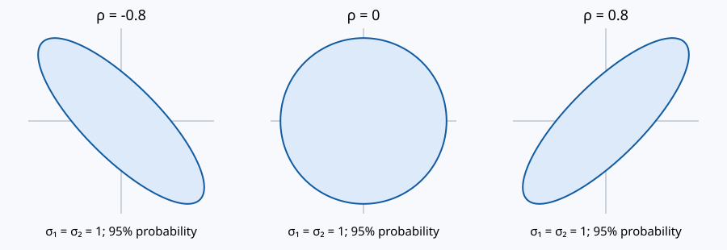

**Data Analytics for AI · Executive M.Tech · IIT Jammu**  
[Previous: transformations](06-transformations.qmd) · [Rigorous supplement](07-normal-supplement.qmd) · [Module overview](../modules.qmd)

## Questions and objectives

Two sensors measure deviations from their calibration targets. Each deviation can be positive or negative. If they share an environmental disturbance, large values may occur together. Knowing each marginal distribution does not determine the probability of simultaneous deviations or the distribution of one sensor after observing the other.

We will construct a multivariate normal vector, define its density and covariance matrix, derive its two-dimensional form, and use its marginals, conditional laws and linear transformations. We will interpret density contours and generate correlated observations. All sensor and financial models below are hypothetical; a normal law is an assumption to examine, not a conclusion from a mean and covariance alone.

## 1. Start with the mean vector and covariance matrix

For $k$ related measurements, let $\mathbf X=(X_1,\ldots,X_k)^T\in\mathbb R^k$. We begin with the stipulated model

$$\boxed{\mathbf X\sim N_k(\boldsymbol\mu,\Sigma)},\qquad
\boldsymbol\mu=\begin{pmatrix}\mu_1\\\vdots\\\mu_k\end{pmatrix},\qquad
\Sigma=(\sigma_{ij})_{i,j=1}^k,$$

where $\mu_i=E[X_i]$ and $\sigma_{ij}=\operatorname{Cov}(X_i,X_j)$. The covariance matrix is symmetric positive semidefinite; assume it is positive definite whenever using an ordinary $k$-dimensional density or $\Sigma^{-1}$. All general derivations below use arbitrary $k$. An affine map $A\in\mathbb R^{m\times k}$ may produce a different number $m$ of outputs. The two- and three-dimensional examples are concrete instances of these statements.

Suppose the joint model for two signed calibration errors is specified as

$$\mathbf X\sim N_2(\boldsymbol\mu,\Sigma),\qquad
\boldsymbol\mu=\begin{pmatrix}0\\0\end{pmatrix},\qquad
\Sigma=\begin{pmatrix}1&1\\1&4\end{pmatrix}.$$

What does this specification tell us about either measurement alone, about the second after observing the first, and about a weighted combination? Those are different distributions derived from the same joint model. We will first interpret the parameters, then derive the general formulas for $N_k(\boldsymbol\mu,\Sigma)$. The normal-family assumption is essential: mean and covariance alone do not specify an arbitrary distribution.

Here the variances are 1 and 4, so the standard deviations are 1 and 2. The covariance is 1, giving correlation $1/2$. The matrix is positive definite because its first leading principal minor is 1 and its determinant is 3. Thus a full two-dimensional density exists. We can construct this specified model as follows.

### A numerical model before the general definition

Let $Z_1,Z_2$ be independent standard normal variables, each with density

$$\phi(z)=\frac1{\sqrt{2\pi}}e^{-z^2/2},\qquad z\in\mathbb R.$$

This is the one-dimensional normal distribution with mean 0 and variance 1. In general, $N(\mu,\sigma^2)$ has mean $\mu$, variance $\sigma^2>0$, and density $\phi((x-\mu)/\sigma)/\sigma$.

Define two sensor errors in a common measurement unit:

$$X_1=Z_1,\qquad X_2=Z_1+\sqrt3 Z_2.$$

Linearity of expectation gives both means zero. Independence gives

$$\operatorname{Var}(X_1)=1,\qquad
\operatorname{Var}(X_2)=1+3=4,$$

$$\operatorname{Cov}(X_1,X_2)=E[Z_1(Z_1+\sqrt3Z_2)]=1.$$

Their correlation is $1/(1\cdot2)=1/2$. The term $Z_1$ shared by the two formulas creates covariance. If we know $X_1=1$, the natural conditional model is $X_2=1+\sqrt3 Z_2$, giving conditional mean 1 and variance 3. We will justify this using the joint density later in the lecture.

### Mean vector and covariance matrix

For a column vector $\mathbf X=(X_1,\ldots,X_k)^T$ with finite second moments, define

$$\boldsymbol\mu=E[\mathbf X],\qquad
\Sigma=E[(\mathbf X-\boldsymbol\mu)(\mathbf X-\boldsymbol\mu)^T].$$

The diagonal entries are variances; entry $(i,j)$ is $\operatorname{Cov}(X_i,X_j)$. In the sensor model,

$$\boldsymbol\mu=\begin{pmatrix}0\\0\end{pmatrix},\qquad
\Sigma=\begin{pmatrix}1&1\\1&4\end{pmatrix}.$$

Every covariance matrix is symmetric and positive semidefinite: for any vector $a$, $a^T\Sigma a=\operatorname{Var}(a^T\mathbf X)\ge0$. Positive definite means this is strictly positive for every nonzero $a$; it excludes a linear combination with zero variance.

## 2. Definition and density

A vector is **multivariate normal**, or **jointly Gaussian**, if every linear combination $a^T\mathbf X$ is a univariate normal variable, allowing a constant as a degenerate normal. Equivalently, it can be represented as

$$\mathbf X=\boldsymbol\mu+A\mathbf Z,$$

where $\mathbf Z$ has independent standard normal components. Its covariance is $AA^T$. We write $\mathbf X\sim N_k(\boldsymbol\mu,\Sigma)$.

For a **positive definite** $k\times k$ covariance matrix, the joint density is

$$f_{\mathbf X}(\mathbf x)=
\frac{1}{(2\pi)^{k/2}|\Sigma|^{1/2}}
\exp\left[-\frac12(\mathbf x-\boldsymbol\mu)^T\Sigma^{-1}(\mathbf x-\boldsymbol\mu)\right],
\qquad\mathbf x\in\mathbb R^k.$$

Here $|\Sigma|$ denotes the determinant. A canonical probability model is $(\mathbb R^k,\mathcal B(\mathbb R^k),P)$ with $P(B)=\int_B f_{\mathbf X}(\mathbf x)d\mathbf x$ and coordinate random variables. The density is nonnegative and integrates to 1. It is not the probability of a point, which is zero.

To see where the formula comes from, choose an invertible $L$ with $LL^T=\Sigma$, and transform independent standard normals by $\mathbf x=\boldsymbol\mu+L\mathbf z$. The inverse Jacobian factor is $1/|\det L|=1/\sqrt{|\Sigma|}$, and $\mathbf z^T\mathbf z=(\mathbf x-\boldsymbol\mu)^T\Sigma^{-1}(\mathbf x-\boldsymbol\mu)$. This applies the previous lecture's change-of-variables rule. The supplement supplies the full normalization argument.

### Worked example: evaluate and interpret a density

For the sensor covariance,

$$|\Sigma|=4-1=3,\qquad
\Sigma^{-1}=\frac13\begin{pmatrix}4&-1\\-1&1\end{pmatrix}.$$

At $\mathbf x=(1,2)^T$, the quadratic form is

$$q=\frac13(4(1)^2-2(1)(2)+(2)^2)=\frac43.$$

Therefore

$$f(1,2)=\frac{1}{2\pi\sqrt3}e^{-2/3}\approx0.04718.$$

This is a density in inverse squared measurement units. A small rectangle centered there with widths $h_1,h_2$ has probability approximately $f(1,2)h_1h_2$ when the density varies little over it. The exact probability is its double integral, not $0.04718$.

**Practice check N1.** For the same model, evaluate the quadratic form and density at $(1,-2)^T$. Explain the comparison with $(1,2)^T$ using the sign of the covariance.

## 3. MGF, characteristic function and moments {#normal-transforms}

### Start with a weighted measurement: what is its distribution?

Suppose two measurements of related quantities are combined into a reported score. In a hypothetical model,

$$\mathbf X\sim N_2\left(\begin{pmatrix}10\\12\end{pmatrix},
\begin{pmatrix}4&2\\2&9\end{pmatrix}\right),\qquad Y=0.6X_1+0.4X_2.$$

All measurements use the same unit. Before deriving any new distribution, calculate

$$E[Y]=0.6(10)+0.4(12)=10.8,$$

$$\operatorname{Var}(Y)=0.6^2(4)+0.4^2(9)+2(0.6)(0.4)(2)=3.84.$$

Now suppose a reported score above 13 triggers a repeat measurement. We need $P(Y>13)$. The mean and variance alone do not generally answer this question: different distributions can share both. We need to establish the distribution of $Y$ under our joint-normal assumption.

One route would construct its CDF as an integral over the region $0.6x_1+0.4x_2\le y$. An MGF offers another route: a weighted sum becomes a substitution into a function we already know. We will define that function, derive it for the Gaussian, and return to this calculation.

### What an MGF records

For a scalar variable, $M_X(t)=E[e^{tX}]$ averages the transformed values $e^{tX}$ over the distribution. Here $t$ is a parameter we choose, not another random observation. Varying it produces a function that can identify the law and provide moments by differentiation. The exponential is useful because $e^{t(X+Y)}=e^{tX}e^{tY}$; independence will let us factor the expectation of this product.

For a real column vector $t\in\mathbb R^k$, the **moment generating function (MGF)** is

$$M_{\mathbf X}(t)=E[\exp(t^T\mathbf X)],$$

where this expectation is finite. A general distribution may not have a finite MGF near zero. A Gaussian vector does: its MGF exists for every real $t$.

### Derive the MGF by completing the square

First let $Z\sim N(0,1)$. Since $tz-z^2/2=-(z-t)^2/2+t^2/2$,

$$E[e^{tZ}]=e^{t^2/2}\int_{\mathbb R}\frac{e^{-(z-t)^2/2}}{\sqrt{2\pi}}dz=e^{t^2/2}.$$

For a positive-definite covariance, put $u=x-\mu$. The exponent in the multivariate density integral satisfies

$$t^Tu-\frac12u^T\Sigma^{-1}u
=-\frac12(u-\Sigma t)^T\Sigma^{-1}(u-\Sigma t)+\frac12t^T\Sigma t.$$

Consequently,

$$\begin{aligned}
M_{\mathbf X}(t)
&=e^{t^T\mu+\frac12t^T\Sigma t}
\int_{\mathbb R^k}\frac{\exp[-\frac12(u-\Sigma t)^T\Sigma^{-1}(u-\Sigma t)]}
{(2\pi)^{k/2}|\Sigma|^{1/2}}du\\
&=\boxed{\exp\left(t^T\mu+\tfrac12t^T\Sigma t\right)}.
\end{aligned}$$

The remaining integral is a translated normalized Gaussian density. For a possibly singular covariance, use $\mathbf X=\mu+A\mathbf Z$ instead: independence gives $M_{\mathbf Z}(v)=\exp(v^Tv/2)$, hence $M_{\mathbf X}(t)=e^{t^T\mu}M_{\mathbf Z}(A^Tt)$ and the same formula with $AA^T=\Sigma$.

### Return to the weighted measurement

The Gaussian MGF just derived is

$$M_{\mathbf X}(t_1,t_2)=\exp\left[10t_1+12t_2+\tfrac12(4t_1^2+4t_1t_2+9t_2^2)\right].$$

Use the definition of $Y$ inside the expectation:

$$\begin{aligned}
M_Y(t)&=E[e^{t(0.6X_1+0.4X_2)}]\\
&=M_{\mathbf X}(0.6t,0.4t)\\
&=\exp\left(10.8t+\tfrac12(3.84)t^2\right).
\end{aligned}$$

This is the MGF of $N(10.8,3.84)$. MGFs that are finite in a neighborhood of zero uniquely identify a distribution, so

$$\boxed{Y\sim N(10.8,3.84).}$$

The requested probability is now

$$P(Y>13)=1-\Phi\left(\frac{13-10.8}{\sqrt{3.84}}\right)
=1-\Phi(1.123\ldots)\approx0.131.$$

Here $\Phi$ is the standard-normal CDF. The standard deviation, not the variance, belongs in the denominator. We have identified the whole law and used it for a decision threshold. We did not assume the measurements were independent: their covariance 2 appears in the joint MGF and in the variance calculation. The general matrix version is derived in subsection 6.

### Read moments from derivatives

The name “moment generating” comes from differentiation. In one dimension,

$$\frac{d}{dt}e^{tX}=Xe^{tX},\qquad
\frac{d^2}{dt^2}e^{tX}=X^2e^{tX}.$$

Setting $t=0$ leaves $X$ and $X^2$. When differentiation can pass through the expectation, $M_X'(0)=E[X]$ and $M_X''(0)=E[X^2]$. For the reported score, this gives $M_Y'(0)=10.8$ and $M_Y''(0)=3.84+10.8^2=120.48$. Subtracting $10.8^2$ recovers variance 3.84. The second derivative gives the second moment, not directly the variance.

For vectors, partial derivatives perform the same operation on chosen coordinates. The gradient is the column of first partial derivatives; the Hessian is the matrix of second partial derivatives. Differentiating under the expectation is justified here by the Gaussian's finite exponential moments. Define $K(t)=\log M_{\mathbf X}(t)$, the **cumulant generating function**. Then

$$\nabla M(0)=E[\mathbf X]=\mu,\qquad
\nabla^2M(0)=E[\mathbf X\mathbf X^T]=\Sigma+\mu\mu^T,$$

$$\nabla K(0)=\mu,\qquad\nabla^2K(0)=\Sigma.$$

Indeed $\partial_iM=(\mu_i+(\Sigma t)_i)M$, and

$$\partial_j\partial_iM=
\left[\Sigma_{ij}+(\mu_i+(\Sigma t)_i)(\mu_j+(\Sigma t)_j)\right]M.$$

Evaluating at zero gives $E[X_iX_j]=\Sigma_{ij}+\mu_i\mu_j$. The Hessian of $M$ gives raw second moments; the Hessian of $\log M$ gives covariance. Gaussian cumulants of order greater than two vanish, but higher moments generally do not.

For our zero-mean sensor model,

$$M(t_1,t_2)=\exp\left[\tfrac12(t_1^2+2t_1t_2+4t_2^2)\right].$$

The second derivatives at zero give $E[X_1^2]=1$, $E[X_1X_2]=1$, and $E[X_2^2]=4$. Setting $(t_1,t_2)=(u,u)$ gives $M_{X_1+X_2}(u)=e^{7u^2/2}$, identifying $X_1+X_2\sim N(0,7)$.

### A second MGF application: combine independent counts

Suppose two independent inspection lines produce defect counts $N_1$ and $N_2$ during a fixed interval. Stipulate $N_j\sim\operatorname{Poisson}(\lambda_j)$, where $\lambda_j>0$ is its mean count. The Poisson PMF is

$$P(N_j=n)=e^{-\lambda_j}\frac{\lambda_j^n}{n!},\qquad n=0,1,2,\ldots.$$

What is the distribution of the combined count $N=N_1+N_2$? From the PMF and the exponential series,

$$\begin{aligned}
M_{N_j}(t)&=\sum_{n=0}^\infty e^{tn}e^{-\lambda_j}\frac{\lambda_j^n}{n!}\\
&=e^{-\lambda_j}\sum_{n=0}^\infty\frac{(\lambda_j e^t)^n}{n!}\\
&=e^{-\lambda_j}e^{\lambda_j e^t}
=\exp\{\lambda_j(e^t-1)\}.
\end{aligned}$$

Independence now provides the useful step:

$$\begin{aligned}
M_N(t)&=E[e^{tN_1}e^{tN_2}]\\
&=E[e^{tN_1}]E[e^{tN_2}]\\
&=\exp\{(\lambda_1+\lambda_2)(e^t-1)\}.
\end{aligned}$$

Recognizing the same Poisson form gives $N\sim\operatorname{Poisson}(\lambda_1+\lambda_2)$. For example, mean counts 2 and 3 give $N\sim\operatorname{Poisson}(5)$, so $P(N=0)=e^{-5}$. The calculation establishes the entire count distribution, not just its mean 5. This model does not assert that actual defect counts are Poisson or independent; those are explicit assumptions.

For independent variables, the transform of a sum is the product of their transforms. Independence is needed for the product rule, not for linearity of expectation. The earlier correlated-measurement example used the **joint** MGF instead of multiplying marginal MGFs.

**Practice check N9.** Two independent Poisson counts have means 1 and 4. Derive the MGF of their total and calculate the probability that the total is at most 1. Explain which step would fail if the counts were dependent.

### Characteristic function: a description that always exists

We would also like to study sums when exponential moments are not finite. A finite mean and variance do not guarantee a finite MGF near zero. We therefore need a transform that remains available. Replace the growing real exponential with a complex exponential of magnitude 1.

For a scalar variable, Euler's formula gives

$$e^{itX}=\cos(tX)+i\sin(tX),\qquad
\varphi_X(t)=E[\cos(tX)]+iE[\sin(tX)].$$

For each outcome this is a point on the unit circle; the expectation averages its horizontal and vertical coordinates. Changing $t$ changes how those points are placed around the circle. The full function retains enough information to identify the distribution. It is a mathematical description of the law, not a probability or a density.

The **characteristic function** is

$$\varphi_{\mathbf X}(t)=E[e^{it^T\mathbf X}],\qquad i^2=-1.$$

Unlike an MGF, it exists for every real $t$ for every probability law, because $|e^{it^T\mathbf X}|=1$. It uniquely determines the law, including laws without a density.

For $Z\sim N(0,1)$, let $\psi(t)=E[e^{itZ}]$. Using $\phi'(z)=-z\phi(z)$ and integration by parts,

$$E[Ze^{itZ}]=-\int e^{itz}\phi'(z)dz=it\psi(t),\qquad
\psi'(t)=iE[Ze^{itZ}]=-t\psi(t).$$

The boundary term vanishes because the Gaussian density tends to zero. With $\psi(0)=1$, the solution is $\psi(t)=e^{-t^2/2}$. Thus, using the affine construction and independence,

$$\boxed{\varphi_{\mathbf X}(t)
=e^{it^T\mu}\prod_j e^{-((A^Tt)_j)^2/2}
=\exp\left(it^T\mu-\tfrac12t^T\Sigma t\right).}$$

This derivation also applies to singular $\Sigma$. It avoids assuming that an arbitrary real MGF can be evaluated at complex arguments. The Gaussian formulas do have that analytic connection, but the characteristic-function definition stands on its own.

### Application preview: why averages become approximately normal

Suppose repeated measurement errors $E_1,E_2,\ldots$ are independent and identically distributed, with mean $\mu$ and finite variance $0<\sigma^2<\infty$. Their individual distribution need not be normal. For example, a stipulated bounded uniform error model meets these conditions.

The average $\bar E_n$ has mean $\mu$ and variance $\sigma^2/n$. To study its *shape* rather than its shrinking scale, define

$$Z_j=\frac{E_j-\mu}{\sigma},\qquad
S_n=\frac{Z_1+\cdots+Z_n}{\sqrt n}
=\frac{\sqrt n(\bar E_n-\mu)}{\sigma}.$$

Each $Z_j$ has mean 0 and variance 1. Independence and the rule for rescaling a transform give

$$\varphi_{S_n}(t)=\left[\varphi_Z\left(\frac{t}{\sqrt n}\right)\right]^n.$$

For small $u$, mean zero and variance one imply

$$\varphi_Z(u)=1-\frac{u^2}{2}+o(u^2).$$

The notation $o(u^2)$ means a remainder whose ratio to $u^2$ tends to zero. The linear term disappears because the mean is zero; the quadratic term records variance one. Substituting into the product gives, for each fixed $t$,

$$\varphi_{S_n}(t)=\left[1-\frac{t^2}{2n}+o(1/n)\right]^n
\longrightarrow e^{-t^2/2}.$$

We recognize the standard-normal characteristic function. The continuity theorem for characteristic functions turns this limit into convergence in distribution: $S_n\xrightarrow{d}N(0,1)$. Thus, for sufficiently large $n$ in a suitable application, the average is approximated by $N(\mu,\sigma^2/n)$.

This is the central limit theorem in the independent, identically distributed, finite-variance setting. It explains why a normal approximation can emerge even when individual errors are not normal. It does not make each individual error normal, establish independence from data, or specify a universally sufficient sample size. It also does not by itself quantify the approximation error for a finite $n$.

The characteristic function is useful here because it turns a sum into a product and lets us recognize the limiting law; no MGF assumption is needed. If the errors are already independent normal variables, the normal law for their average is exact for every $n$. The [supplement gives the expansion and continuity theorem precisely](07-normal-supplement.qmd#clt-transform-preview); the convergence module will revisit this argument.

**Practice check N10.** Independent observations have common mean 10 and variance 9. For the mean of 36 observations, identify the normal approximation's mean and variance and write the approximate probability that the sample mean exceeds 11 in terms of $\Phi$. Under what stronger distributional assumption is this calculation exact?

**Practice check N6.** For $\mu=(1,-2)^T$ and $\Sigma=\begin{pmatrix}4&1\\1&9\end{pmatrix}$, write the MGF and characteristic function. Use derivatives at zero to obtain $E[X_1X_2]$. Compare that answer with the covariance entry.

**Stopping point.** Check the sign of the quadratic term in each transform, and distinguish raw second moments from covariance, before deriving new distributions.

## 4. The two-dimensional formula and its geometry

Write

$$\Sigma=\begin{pmatrix}
\sigma_1^2&\rho\sigma_1\sigma_2\\
\rho\sigma_1\sigma_2&\sigma_2^2
\end{pmatrix},\qquad \sigma_1,\sigma_2>0,\quad |\rho|<1.$$

Its determinant is $\sigma_1^2\sigma_2^2(1-\rho^2)>0$. Put $z_i=(x_i-\mu_i)/\sigma_i$. The density becomes

$$f(x_1,x_2)=\frac{1}{2\pi\sigma_1\sigma_2\sqrt{1-\rho^2}}
\exp\left[-\frac{z_1^2-2\rho z_1z_2+z_2^2}{2(1-\rho^2)}\right].$$

At fixed density, the quadratic form $q=(\mathbf x-\boldsymbol\mu)^T\Sigma^{-1}(\mathbf x-\boldsymbol\mu)$ is constant. If $\Sigma=Q\Lambda Q^T$ with orthonormal eigenvectors and positive eigenvalues $\lambda_i$, coordinates $\mathbf u=Q^T(\mathbf x-\boldsymbol\mu)$ give

$$q=\frac{u_1^2}{\lambda_1}+\frac{u_2^2}{\lambda_2}.$$

Contours are ellipses centered at the mean, with principal directions given by the eigenvectors and semiaxis lengths $\sqrt{c\lambda_i}$ at $q=c$. Positive correlation tilts contours toward pairs with matching signs of standardized deviations; negative correlation favors opposite signs. Marginal standard deviations and principal-axis standard deviations are generally different quantities.

{fig-alt="Three Gaussian probability ellipses with correlation minus 0.8, zero and plus 0.8."}

[Open the bivariate-normal density and conditioning explorer](../materials/07-multivariate-normal/bivariate-normal.html). Change correlation, means and scales. Compare the density heatmap and its contour with the marginal and conditional curves. The density color scale is displayed; use the numerical values when comparing models.

### A contour is not itself a probability

For this bivariate normal law,

$$P(q\le c)=1-e^{-c/2},\qquad c\ge0.$$

Thus the ellipse $q\le1$ contains about $39.35\%$, not $68\%$, of the probability. A 95% **probability ellipse** uses $c=-2\log(0.05)\approx5.991$. It describes the distribution of observations under known parameters; it is not automatically a confidence region for an estimated mean. The contour line itself has probability zero. The supplement derives the interior probability by polar integration.

## 5. Marginal and conditional normal laws

### Marginals retain coordinates

Ignoring the second sensor in the construction gives $X_1=Z_1\sim N(0,1)$. Ignoring the first gives $X_2=Z_1+\sqrt3Z_2\sim N(0,4)$. This illustrates the general property: every subvector of a jointly normal vector is normal, with the corresponding subvector of means and covariance submatrix.

The statement that $X_2$ is normal follows from joint normality of the independent normal inputs and the linear-combination property. Having normally shaped marginal distributions alone would not justify the full joint model.

### Condition on one observed sensor

Complete the square in the bivariate exponent:

$$\frac{z_1^2-2\rho z_1z_2+z_2^2}{1-\rho^2}
=z_1^2+\frac{(z_2-\rho z_1)^2}{1-\rho^2}.$$

The joint density factors into the marginal density of $X_1$ and a normal density in $X_2$. Therefore a natural conditional version is

$$X_2\mid X_1=x\sim N\left(
\mu_2+\rho\frac{\sigma_2}{\sigma_1}(x-\mu_1),\quad
\sigma_2^2(1-\rho^2)\right).$$

Conditioning shifts the mean linearly and reduces the variance unless $\rho=0$. This is a density-based conditional law at a continuous value; it does not divide by the zero probability $P(X_1=x)$.

For the sensor model, $\mu_1=\mu_2=0$, $\sigma_1=1$, $\sigma_2=2$, $\rho=1/2$. At $X_1=1$,

$$E[X_2\mid X_1=1]=1,\qquad
\operatorname{Var}(X_2\mid X_1=1)=4(1-1/4)=3.$$

Let $\Phi(t)=\int_{-\infty}^t\phi(z)dz$ be the standard-normal CDF. A further probability calculation is

$$P(X_2>2\mid X_1=1)=1-\Phi\left(\frac{2-1}{\sqrt3}\right)\approx0.282,$$

whereas $P(X_2>2)=1-\Phi(1)\approx0.159$. The conditioning information changes the question and the result; it does not establish a causal relation between sensors.

**Practice check N2.** In this sensor model, give the conditional mean and variance at $X_1=-1$. Write $P(X_2>0\mid X_1=-1)$ in terms of $\Phi$.

### General partition: derive both marginal and conditional densities

Suppose only some coordinates are observed. Write

$$\mathbf X=\begin{pmatrix}U\\V\end{pmatrix},\quad
\mu=\begin{pmatrix}\mu_U\\\mu_V\end{pmatrix},\quad
\Sigma=\begin{pmatrix}\Sigma_{UU}&\Sigma_{UV}\\\Sigma_{VU}&\Sigma_{VV}\end{pmatrix},$$

where $U\in\mathbb R^r$, $V\in\mathbb R^s$, $r+s=k$, and for this density derivation $\Sigma$ is positive definite. Define

$$B=\Sigma_{VU}\Sigma_{UU}^{-1},\qquad
C=\Sigma_{VV}-\Sigma_{VU}\Sigma_{UU}^{-1}\Sigma_{UV}.$$

The matrix $C$ is the **Schur complement**; here it is positive definite. The factorization

$$\Sigma=
\begin{pmatrix}I&0\\B&I\end{pmatrix}
\begin{pmatrix}\Sigma_{UU}&0\\0&C\end{pmatrix}
\begin{pmatrix}I&B^T\\0&I\end{pmatrix}$$

gives $|\Sigma|=|\Sigma_{UU}||C|$ and, with $u_0=u-\mu_U$, $v_0=v-\mu_V$,

$$\begin{pmatrix}u_0\\v_0\end{pmatrix}^{T}\Sigma^{-1}
\begin{pmatrix}u_0\\v_0\end{pmatrix}
=u_0^T\Sigma_{UU}^{-1}u_0+(v_0-Bu_0)^TC^{-1}(v_0-Bu_0).$$

Substitute both identities into the joint density. It separates as

$$f_{U,V}(u,v)=
\underbrace{\frac{e^{-u_0^T\Sigma_{UU}^{-1}u_0/2}}{(2\pi)^{r/2}|\Sigma_{UU}|^{1/2}}}_{g(u)}
\underbrace{\frac{e^{-(v_0-Bu_0)^TC^{-1}(v_0-Bu_0)/2}}{(2\pi)^{s/2}|C|^{1/2}}}_{h(v;u)}.$$

For each fixed $u$, $h(v;u)$ is a normalized normal density in $v$. Therefore

$$f_U(u)=\int f_{U,V}(u,v)dv=g(u),\qquad
f_{V\mid U}(v\mid u)=\frac{f_{U,V}(u,v)}{f_U(u)}=h(v;u).$$

We have derived, rather than assumed,

$$\boxed{U\sim N_r(\mu_U,\Sigma_{UU}),\qquad
V\mid U=u\sim N_s(\mu_V+B(u-\mu_U),C).}$$

Interchanging the blocks also gives $V\sim N_s(\mu_V,\Sigma_{VV})$. A marginal retains the corresponding covariance block; a conditional subtracts the explained covariance. The conditional covariance does not depend on the observed value $u$, although the conditional mean does. The reduction $\Sigma_{VV}-C=\Sigma_{VU}\Sigma_{UU}^{-1}\Sigma_{UV}$ is positive semidefinite, so conditioning cannot increase variance along any fixed direction in this Gaussian model.

The conditional transforms follow directly:

$$M_{V\mid U=u}(t)=\exp\left[t^T(\mu_V+B(u-\mu_U))+\tfrac12t^TCt\right],$$

$$\varphi_{V\mid U=u}(t)=\exp\left[it^T(\mu_V+B(u-\mu_U))-\tfrac12t^TCt\right].$$

A marginal CDF or joint CDF is obtained by integrating its density over the threshold region. For example, $F_{\mathbf X}(x)=\int_{-\infty}^{x_1}\cdots\int_{-\infty}^{x_k}f_{\mathbf X}(u)du_k\cdots du_1$. There is generally no elementary closed formula for these integrals. A conditional normal probability can instead be standardized using its conditional mean and covariance.

### Worked block calculation: two outputs after one observation

Let a hypothetical three-channel calibration vector have

$$\mu=\begin{pmatrix}1\\2\\-1\end{pmatrix},\qquad
\Sigma=\begin{pmatrix}4&2&0\\2&5&1\\0&1&2\end{pmatrix}.$$

Its leading principal minors are $4,16,28$, all positive. Take $U=X_1$ and $V=(X_2,X_3)^T$. Then

$$B=\begin{pmatrix}2\\0\end{pmatrix}\frac14
=\begin{pmatrix}1/2\\0\end{pmatrix},\qquad
C=\begin{pmatrix}5&1\\1&2\end{pmatrix}
-\frac14\begin{pmatrix}4&0\\0&0\end{pmatrix}
=\begin{pmatrix}4&1\\1&2\end{pmatrix}.$$

Consequently,

$$V\sim N_2\left(\begin{pmatrix}2\\-1\end{pmatrix},\begin{pmatrix}5&1\\1&2\end{pmatrix}\right),$$

$$V\mid X_1=3\sim N_2\left(\begin{pmatrix}3\\-1\end{pmatrix},\begin{pmatrix}4&1\\1&2\end{pmatrix}\right).$$

Observing the first channel shifts the second channel's mean and reduces its variance; the third channel's marginal conditional law is unchanged because its covariance with the first is zero. The second and third channels remain correlated.

**Practice check N7.** In this model, condition instead on $X_1=-1$. Find the two-dimensional conditional law and the distribution of $X_2+X_3$ given this observation.

### Independence is a special normal-model property

For jointly normal scalar components, zero covariance is equivalent to independence. In the bivariate formula, $\rho=0$ removes the cross term and makes the density the product of two marginal normal densities. The same principle applies to subvectors whose cross-covariance matrix is zero.

The qualification **jointly normal** matters. Let $Z\sim N(0,1)$ and independently choose $B=+1$ or $-1$ with equal probabilities. Set $X=Z$, $Y=BZ$. Both marginals are standard normal and $E[XY]=E[B]E[Z^2]=0$. Yet $|X|=|Y|$ surely, so they are dependent. Also $X+Y$ has a point mass of $1/2$ at zero and is not a nondegenerate normal variable. Thus the vector is not jointly normal.

**Stopping point.** Compare a marginal distribution, a conditional distribution, and the independence condition before applying matrix transformations.

## 6. Linear transformations, generation and whitening

### Worked example: a weighted financial quantity

Suppose two modelled daily changes, in percentage points, are jointly normal with means 0.1 and 0.2, standard deviations 1 and 2, and correlation $1/2$. Their covariance matrix is the sensor matrix. For $R=0.6X_1+0.4X_2$,

$$E[R]=0.6(0.1)+0.4(0.2)=0.14,$$

$$\operatorname{Var}(R)=0.6^2(1)+0.4^2(4)+2(0.6)(0.4)(1)=1.48.$$

Because this is a linear combination of jointly normal variables,

$$R\sim N(0.14,1.48).$$

For example, $P(R<0)=\Phi(-0.14/\sqrt{1.48})\approx0.454$. This is a calculation within an invented model, not a financial forecast. The mean and variance calculation is valid beyond normal distributions, but the conclusion that $R$ is normal needs the joint-normal assumption.

In general,

$$\mathbf X\sim N_k(\boldsymbol\mu,\Sigma)
\quad\Longrightarrow\quad
A\mathbf X+b\sim N_m(A\boldsymbol\mu+b,A\Sigma A^T).$$

The new covariance may be singular, even if the original covariance is positive definite, when $A$ has deficient row rank.

### Derive the affine law using the MGF

For a fixed $m\times k$ matrix $A$, $b\in\mathbb R^m$ and $Y=A\mathbf X+b$,

$$\begin{aligned}
M_Y(t)&=E[e^{t^T(A\mathbf X+b)}]=e^{t^Tb}M_{\mathbf X}(A^Tt)\\
&=\exp\left[t^T(A\mu+b)+\tfrac12t^T(A\Sigma A^T)t\right].
\end{aligned}$$

This is the MGF of the stated normal law. The same calculation with characteristic functions proves the result even for a singular transformed covariance. Also, directly from centered variables,

$$E[Y]=A\mu+b,\qquad
E[(Y-EY)(Y-EY)^T]=A\Sigma A^T.$$

The moment identities hold for any vector with finite second moments. Gaussianity supplies the additional conclusion about the entire law. For $A\Sigma A^T$ positive definite, substitute these new parameters into the normal density; if it is singular, there is no full $m$-dimensional density. An invertible square $A$ also permits the direct Jacobian check $f_Y(y)=f_{\mathbf X}(A^{-1}(y-b))/|\det A|$.

A coordinate-selection matrix proves the marginal law another way: selecting components selects the corresponding rows and columns of $\Sigma$. A row vector $a^T$ gives $a^T\mathbf X\sim N(a^T\mu,a^T\Sigma a)$.

### Worked transformation producing independent coordinates

For the original sensor model, take

$$Y=\begin{pmatrix}X_1\\X_2-X_1\end{pmatrix},\qquad
A=\begin{pmatrix}1&0\\-1&1\end{pmatrix}.$$

Then

$$A\Sigma=\begin{pmatrix}1&1\\0&3\end{pmatrix},\qquad
A\Sigma A^T=\begin{pmatrix}1&0\\0&3\end{pmatrix}.$$

Thus $Y_1\sim N(0,1)$ and $Y_2\sim N(0,3)$ independently. The residual $X_2-X_1$ has removed the component associated with the first sensor. In contrast, selecting $Y=(X_1,2X_1)^T$ yields covariance $\begin{pmatrix}1&2\\2&4\end{pmatrix}$ and a law supported on a line.

### Generate the desired covariance

For the two-dimensional parameterization, independent $Z_1,Z_2\sim N(0,1)$ give

$$X_1=\mu_1+\sigma_1Z_1,\qquad
X_2=\mu_2+\sigma_2\left(\rho Z_1+\sqrt{1-\rho^2}Z_2\right).$$

Then $\operatorname{Cov}(X_1,X_2)=\rho\sigma_1\sigma_2$, while the second variance is $\sigma_2^2[\rho^2+(1-\rho^2)]=\sigma_2^2$. This is the two-dimensional Cholesky construction $\mathbf X=\boldsymbol\mu+L\mathbf Z$.

Conversely, for invertible $L$ with $LL^T=\Sigma$,

$$\mathbf Z=L^{-1}(\mathbf X-\boldsymbol\mu)\sim N_k(0,I).$$

This operation is called **whitening**. For the sensor example, $Z_1=X_1$ and $Z_2=(X_2-X_1)/\sqrt3$. Dividing each original coordinate by its own standard deviation only standardizes the marginals; it leaves correlation $1/2$ and does not whiten.

[Open the generation and whitening demonstration](../materials/07-multivariate-normal/normal-generation.html). The same fixed simulated standard-normal pairs are transformed as correlation changes. Compare population covariance with the finite simulated sample covariance; they need not coincide exactly.

**Practice check N3.** For the sensor model, find the distribution of $X_2-X_1$. Verify that its variance agrees with the construction in independent $Z_1,Z_2$.

## 7. One model: joint, marginal, conditional and transformed laws

For the hypothetical model

$$\mathbf X\sim N_2\left(\begin{pmatrix}1\\2\end{pmatrix},
\begin{pmatrix}4&2\\2&9\end{pmatrix}\right),$$

the determinant is $32$ and the inverse covariance is $\tfrac1{32}\begin{pmatrix}9&-2\\-2&4\end{pmatrix}$. Writing $u=x_1-1$, $v=x_2-2$, the full density is

$$f(x_1,x_2)=\frac1{2\pi\sqrt{32}}
\exp\left[-\frac{9u^2-4uv+4v^2}{64}\right].$$

The marginal laws are $X_1\sim N(1,4)$ and $X_2\sim N(2,9)$. They are dependent because their covariance is 2. Their joint MGF is

$$M(t_1,t_2)=\exp\left[t_1+2t_2+\tfrac12(4t_1^2+4t_1t_2+9t_2^2)\right].$$

Replace its linear term with $i(t_1+2t_2)$ and negate the quadratic term to obtain the characteristic function. The raw mixed moment is $E[X_1X_2]=2+(1)(2)=4$.

After observing $X_1=3$,

$$X_2\mid X_1=3\sim N\left(2+\frac24(3-1),9-\frac{2^2}{4}\right)=N(3,8).$$

Thus $P(X_2>5\mid X_1=3)=1-\Phi(2/\sqrt8)$. Without that observation, the probability is $1-\Phi((5-2)/3)=1-\Phi(1)$.

For the derived quantity $D=X_2-2X_1$,

$$E[D]=2-2(1)=0,\qquad
\operatorname{Var}(D)=9+4(4)-4(2)=17,$$

so $D\sim N(0,17)$. Its MGF is $e^{17t^2/2}$. The cross-covariance $\operatorname{Cov}(D,X_1)=2-2(4)=-6$ shows that this particular transformed quantity is not independent of the first coordinate.

| Question | Operation on the model | Result |
|---|---|---|
| What can both coordinates do together? | Use $\mu,\Sigma$ in the joint density | A density over $\mathbb R^2$ |
| What if one coordinate is ignored? | Retain its mean and variance | Marginal normal law |
| What if one coordinate is observed? | Conditional mean update and Schur complement | Conditional normal law |
| What if we calculate a linear quantity? | Apply $A\mu+b$ and $A\Sigma A^T$ | Affine normal law |
| How do we extract moments or identify laws? | Differentiate the MGF, or use transform uniqueness | Moments and distributional identities |

**Practice check N8.** For this last model, derive the joint law of $(X_1+X_2,X_2-X_1)^T$. Give its MGF and decide whether the transformed coordinates are independent. Then derive $X_1\mid X_2=5$.

**Classroom sequence.** A useful first stopping point is the density and transform derivations. Resume with bivariate completion of the square, then the block conditional law, and finish with the affine worked calculations. The two existing interactive demonstrations support the geometry and conditioning discussions; the algebra specifies the distributions they display.

## 8. Boundary cases and what the model does not establish

At $|\rho|=1$, $|\Sigma|=0$ and the density formula involving $\Sigma^{-1}$ is unavailable. A Gaussian distribution can still exist: for example $X_2=2X_1$ with $X_1\sim N(0,1)$ is concentrated on a line. It has no density with respect to two-dimensional area. The interactive density explorer restricts $|\rho|<1$ so it always displays a genuine planar density.

A normal distribution has unbounded support. It can be a stipulated model for signed errors or changes, but using it for an inherently nonnegative duration requires considering the negative values it permits. Normal-looking marginals, an elliptical scatterplot, and a computed covariance do not by themselves prove joint normality. Distributional assumptions must be assessed using the context and data.

**Practice check N4.** Explain why $\begin{pmatrix}1&2\\2&1\end{pmatrix}$ cannot be a covariance matrix. Find a linear combination whose proposed variance would be negative.

**Practice check N5.** Find the constant $c$ for a bivariate normal probability ellipse containing 90% of observations. Does its contour line have probability 90%?

## References and module continuation

For transform formulas and an alternative affine-normal derivation, see Marco Taboga, [Multivariate normal distribution](https://www.statlect.com/probability-distributions/multivariate-normal-distribution), sections “Joint moment generating function” and “Joint characteristic function”. The calculations and worked examples here develop these identities explicitly.

The bivariate construction, density and conditional law were checked against Pishro-Nik's [§5.3.2, Bivariate Normal Distribution](https://www.probabilitycourse.com/chapter5/5_3_2_bivariate_normal_dist.php). Penn State's [STAT 505, Lesson 4](https://online.stat.psu.edu/stat505/Lesson04) gives additional multivariate-normal reading. See the [supplement](07-normal-supplement.qmd) for normalization, block conditioning, singular cases and the ellipse calculation.

Together, 01.5–01.7 develop expectation and joint moments, distributions of functions, generation of random variables, and a tractable multivariate model. The next module studies sequences of random variables, random processes and convergence; the stopping points here allow time to consolidate the calculations first.
